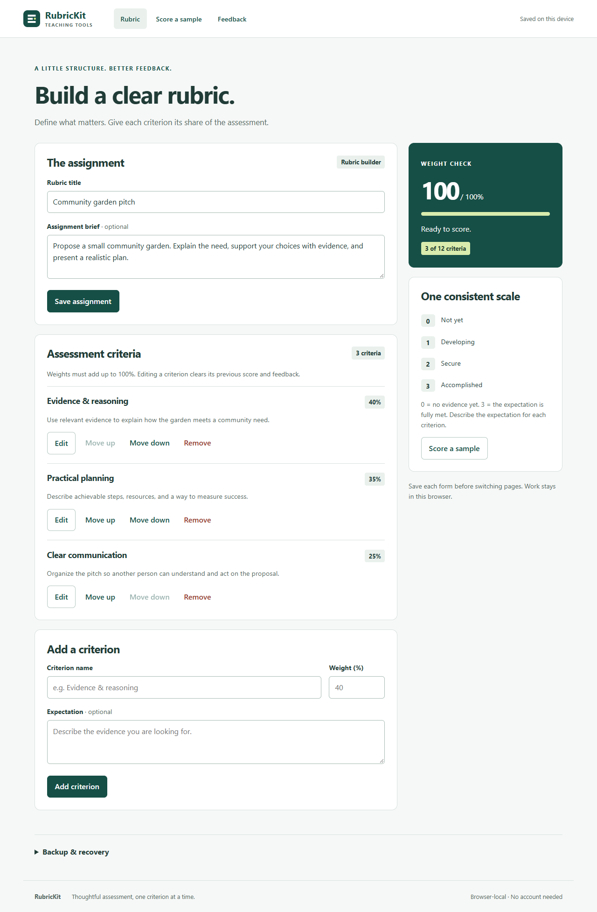
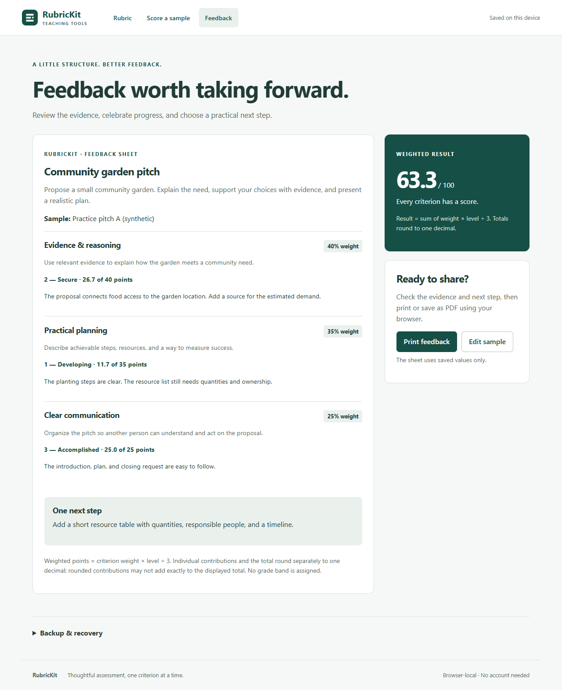

# RubricKit

A browser-local rubric builder for educators who want transparent scores and
useful feedback without an account or uploading learner work.

Build a weighted rubric, score one anonymous sample, and print a feedback sheet.
Plain HTML, CSS and JavaScript; no runtime dependencies, AI or external services.



## Run locally

Use Node.js 22 or newer. Serving the app needs no package installation:

```sh
node scripts/serve.mjs
```

Open http://127.0.0.1:4195. Use a local HTTP server, not `file://`, because the app
uses JavaScript modules and browser-origin storage. Stop with Ctrl+C.

For tests and development tools:

```sh
npm ci
npm test
npm run lint
npm run build
npm run check:build
```

Browser tests use installed Microsoft Edge on Windows:

```sh
npm run test:e2e
npm run screenshots
```

On Linux, install Playwright Chromium and set `CI=1` for the browser commands:

```sh
npx playwright install --with-deps chromium
CI=1 npm run test:e2e
```

The production build contains nine public assets in `dist/`. A static host can
serve that folder. No secrets or environment variables are required, so no
`.env.example` is needed. `SERVE_DIST=1` selects production files for the local
preview server. Port 4195 must be free. The included server is for local preview.

## Try the main journey

1. Open **Backup & recovery** and choose **Load synthetic demo**, confirming replacement.
2. On **Rubric**, inspect the three criteria and weights: 40%, 35%, 25%.
3. On **Score a sample**, inspect the levels: 2, 1, 3. The total is **63.3 / 100**.
4. Change a level or feedback, choose **Save sample**, then open **Feedback**.
5. Choose **Print feedback** to use the browser print/PDF dialog.
6. Export a JSON backup; restoring it replaces the saved workspace after validation and confirmation.

Or start empty: save an assignment, add criteria totalling 100%, then score them.
Each form saves explicitly. Unsaved navigation and actions that discard another
form's work require confirmation. Blank scores are incomplete; level 0 is a real score.

## Design and arithmetic

- Three focused pages share a restrained green visual system, readable forms,
  labeled controls, visible focus, a skip link, mobile editor shortcuts and favicon.
- 1–12 criteria; integer weights 1–100, exactly 100 in total before scoring.
- Four fixed levels: 0 Not yet, 1 Developing, 2 Secure, 3 Accomplished.
- Weighted points = `weight × level / 3`. Sum the unrounded contributions, then
  round the displayed total to one decimal. Rounded rows may sum differently.
- All criteria need a score for a total. No grade bands or automated grading decisions.
- Editing a criterion clears its score and feedback to prevent stale assessments;
  reordering preserves them. Removing a criterion clears its associated values.
- Backup imports enforce version, size (100,000 bytes), identifiers, text limits,
  integer weights/levels and references. Text is rendered as text, not HTML.

## Storage and limits

One rubric and one anonymous sample live in localStorage on the current browser
origin. There is no cloud sync, account, roster, multi-submission history, service
worker or cross-device backup. Changing host/port uses a different workspace.
Clearing browser data deletes the saved work. Export backups regularly.

Unavailable/quota-limited storage reports failure and leaves the current form
intact. Corrupt data is not overwritten: download the raw data before explicitly
clearing it, then restore a valid backup. The raw download is for recovery, not a
guarantee that corrupted data can be restored automatically.

Stale tabs compare their saved snapshot before writing and show an error if the
workspace changed. This is a best-effort localStorage guard, not a transactional
multi-user database; avoid simultaneous saves in multiple tabs.

This tool is for rubric design and anonymous practice samples. Browser storage
and exported JSON are not encrypted. No real learner data is included.
Fixed performance labels and simple weights may not fit institutional rubrics.
No custom level descriptors, network sharing or accessibility certification is claimed.

## Verification

10 Node tests and 11 browser tests pass locally. Static lint checks 16 files;
production verification checks nine HTTP 200 assets and development/missing-file
404s. Browser coverage includes the main journey, incomplete and zero results,
edits, deletion confirmation, backups, corrupt storage, stale tabs, escaped text,
unsaved navigation, print styles and 1280/390/320px layouts.

See [verification evidence and limitations](docs/VERIFICATION.md). CI runs the
same unit/lint/build/HTTP/browser checks on Ubuntu with Node 22 and Chromium.



[Mobile screenshot](docs/mobile.png) · [Print CSS screenshot](docs/print.png)

All demonstration content is original synthetic data. No paid services, API keys
or external content are required. Project scope is in [PROJECT_BRIEF.md](PROJECT_BRIEF.md).
